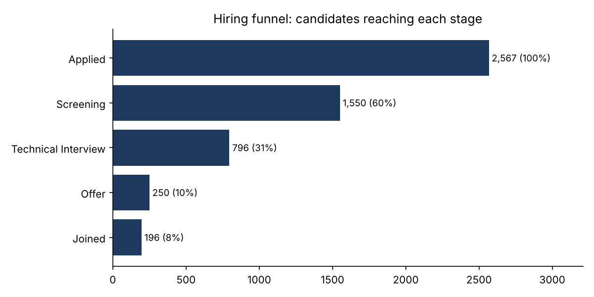
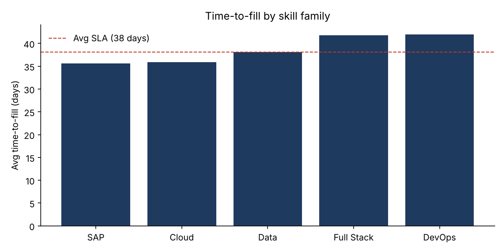
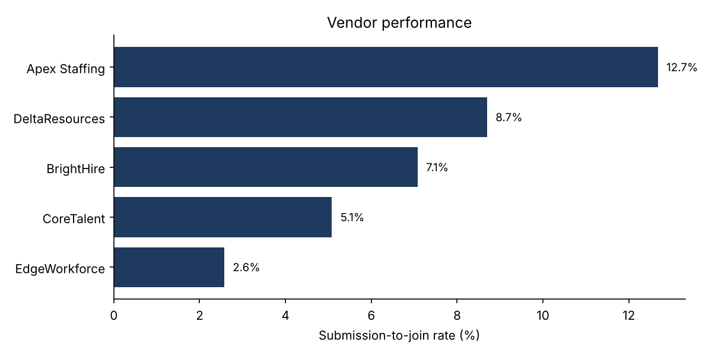
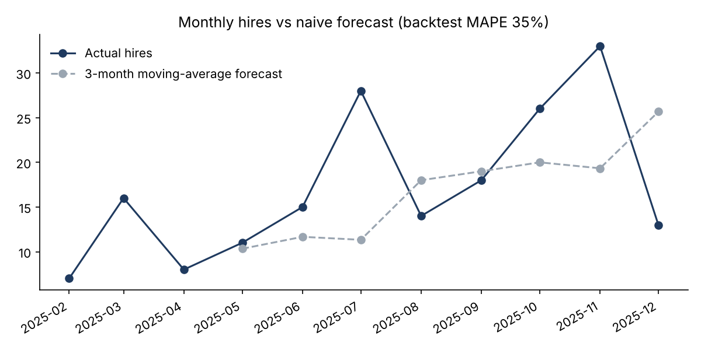

# Hiring Funnel & Pipeline Analytics (SQL + Python + Power BI)

End-to-end analytics project on a **synthetic recruitment dataset**: generate and clean messy data,
query it with SQL (CTEs and window functions), analyse it with pandas, and model it for a Power BI dashboard.

> **Data note:** all data is randomly generated by `src/generate_data.py` (seeded, reproducible).
> It contains no real candidates, companies or client information. Findings below describe the synthetic
> data and show the method, not real-world results.

## Business questions
1. Where do candidates drop out of the hiring funnel?
2. How long do requisitions take to fill, and how often is the SLA missed?
3. Which staffing vendors convert submissions into joiners?
4. How do hires trend month to month, and is a simple forecast good enough?

## Project structure
```
src/generate_data.py   create raw CSVs with deliberate data-quality problems
src/clean_data.py      pandas cleaning + validation (logs every fix)
src/run_sql.py         loads cleaned data into SQLite and runs sql/queries.sql
src/analysis.py        funnel, time-to-fill, vendor analysis, charts, naive forecast
sql/                   schema + 6 analytical queries
powerbi/               star-schema design and DAX measures
outputs/               charts, SQL results, data-quality log, summary
```

## How to run
```bash
pip install -r requirements.txt
python src/generate_data.py
python src/clean_data.py
python src/run_sql.py
python src/analysis.py
```

## What the pipeline does
**Cleaning (pandas)** - fixes inconsistent casing and whitespace, fills missing sources, removes duplicate
rows, drops stage events dated before the application date, and checks referential integrity.
See `outputs/data_quality_log.txt`.

**SQL** - `sql/queries.sql` uses joins, CTEs, subqueries and window functions (`LAG`, `LEAD`, `RANK`,
`FIRST_VALUE`, running `SUM`) for funnel conversion, time-to-fill vs SLA, vendor ranking, monthly trend,
stage-transition timing and source effectiveness.

**Python analysis** - charts and a 3-month moving-average forecast backtested against actual hires.

**Power BI** - `powerbi/` documents the star schema and DAX measures (MTD / QTD / YTD, offer-to-join %,
SLA breach %).

## Sample findings (synthetic data)
- 2,567 applications led to 196 joiners (7.6% overall); the biggest drop is Technical Interview to Offer (31% pass).
- 101 of 150 requisitions were filled, averaging 39 days; 47% breached their SLA.
- Vendor submission-to-join rates range from 12.7% (best) to 2.6% (weakest).
- A naive 3-month moving average has a backtest MAPE of about 35%, so it is a baseline to improve on, not a finished forecast.






## Possible extensions
Add a Power BI report file and screenshots, a proper forecasting model, and statistical tests on vendor differences.

## Skills demonstrated
SQL (CTEs, window functions) | Python (pandas, numpy, matplotlib) | data cleaning and validation | Power BI data modelling and DAX | funnel and SLA analytics
